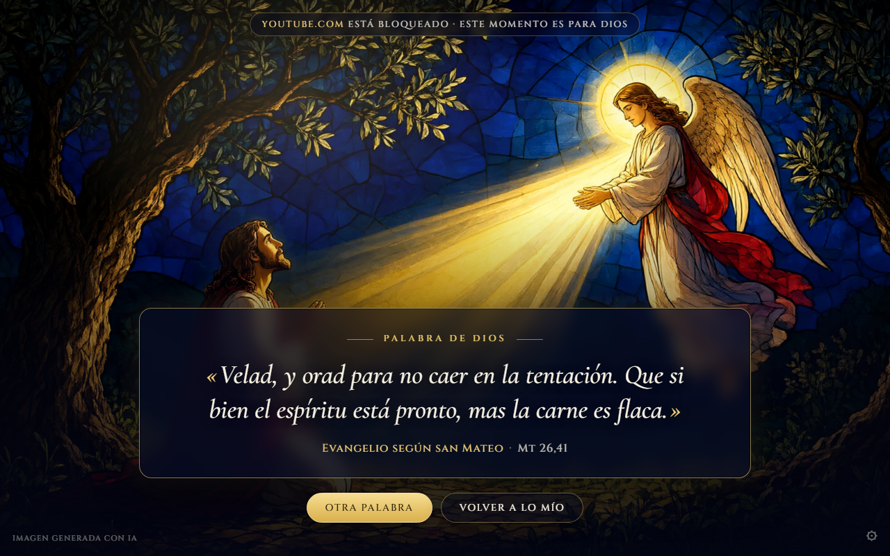
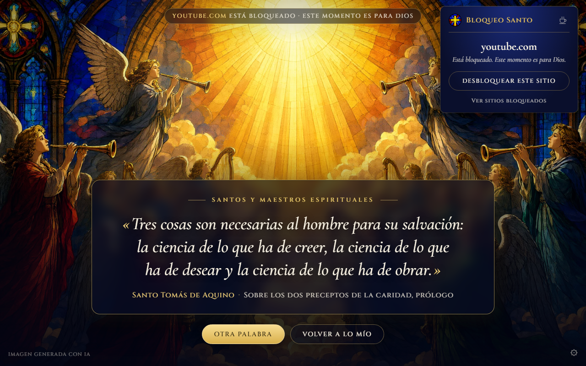

  

<h1 align="center">Bloqueo Santo</h1>

<em>Convierte cada distracción en un momento con Dios.</em>

Bloqueo Santo es una extensión gratuita para **Google Chrome** y **Microsoft Edge**. Bloquea los sitios que te distraen y, cuando intentas abrirlos, en lugar de un aviso vacío te muestra un vitral luminoso con una cita para meditar, tomada de la Sagrada Escritura, del Catecismo de la Iglesia Católica o de los santos.

La idea es sencilla: que el momento de la tentación o de la distracción se vuelva una ocasión para crecer espiritualmente.

  

## Instalación

Muy pronto estará disponible en la **Chrome Web Store** y en **Edge Add-ons**. Bastará con pulsar «Añadir» desde la tienda; no hace falta configurar nada más.

## Cómo se usa

- **Bloquear un sitio:** estando en él, pulsa el icono de la cruz en la barra del navegador y luego **Bloquear este sitio**. La pestaña pasa al instante a la página de bloqueo.
- **Desbloquearlo:** desde la página de bloqueo, pulsa el icono y luego **Desbloquear este sitio**. Volverás a la página que intentabas abrir.
- **Otra palabra** (o la barra espaciadora): te muestra otra cita y otro vitral. Las citas recientes no se repiten.
- **Ajustes** (el engranaje ⚙ o «Ver sitios bloqueados»): para ver y editar tu lista de sitios.

  

## Las citas

Hay 136 citas: 65 de la Sagrada Escritura, 49 de santos, papas y maestros espirituales, y 22 del Catecismo. Cada una lleva su autor y su referencia. Para respetar los derechos de autor, solo se usan estas fuentes:

- **Dominio público.** La Escritura se cita según la traducción de *Félix Torres Amat* (1823-1825). Santa Teresa de Jesús, san Juan de la Cruz y san Ignacio de Loyola se citan por su texto castellano original.
- **Traducción propia.** Los santos que escribieron en latín, francés, italiano o inglés se citan en una traducción fiel hecha para esta extensión desde el original, que es de dominio público.
- **Textos de la Santa Sede.** El Catecismo y los documentos papales se citan breves y según su texto oficial de vatican.va. © Libreria Editrice Vaticana.

La fuente de cada cita se puede consultar dentro de la extensión, en **Fuentes y créditos**.

## Las imágenes

Todos los vitrales y el icono son **ilustraciones generadas con inteligencia artificial**, creadas para esta extensión con fines devocionales. No son fotografías ni reproducciones de obras existentes, y pueden tener imprecisiones artísticas o iconográficas.

## Privacidad

Bloqueo Santo no recoge ni envía ningún dato. No tiene anuncios, ni analíticas, ni servidores. Tu lista de sitios se guarda en tu navegador y, si tienes activada la sincronización, en tu propia cuenta del navegador.

Política de privacidad completa: <https://duv2312-art.github.io/bloqueo-santo/politica-privacidad.html>

## ¿Encontraste un error?

Si una cita o su referencia tiene un error, o algo no funciona, escribe a **duv5555@hotmail.com** o abre un [*issue*](https://github.com/duv2312-art/bloqueo-santo/issues) en este repositorio.

## Apoyar el proyecto

Bloqueo Santo es gratis y lo seguirá siendo. Si te ayuda y quieres invitar un café, es completamente voluntario: <https://paypal.me/dosvan00>. ¡Gracias, y que Dios te bendiga!

## Lo que viene

Si el tiempo de Dios lo permite, en próximas actualizaciones:

- más variedad de imágenes;
- citas propias;
- traducción a otros idiomas.

---

<em>«Velad, y orad para no caer en la tentación» (Mt 26,41).</em>

